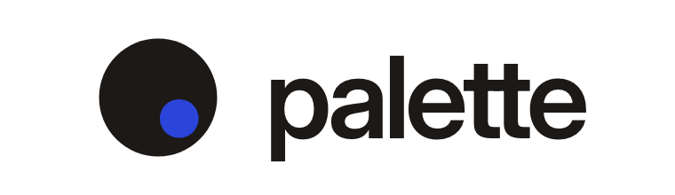
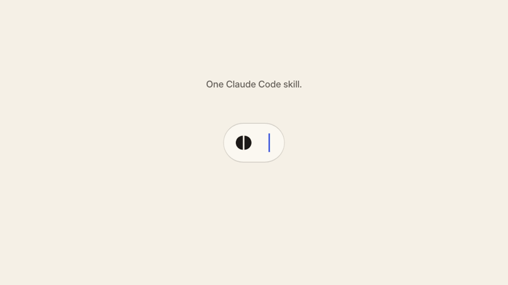
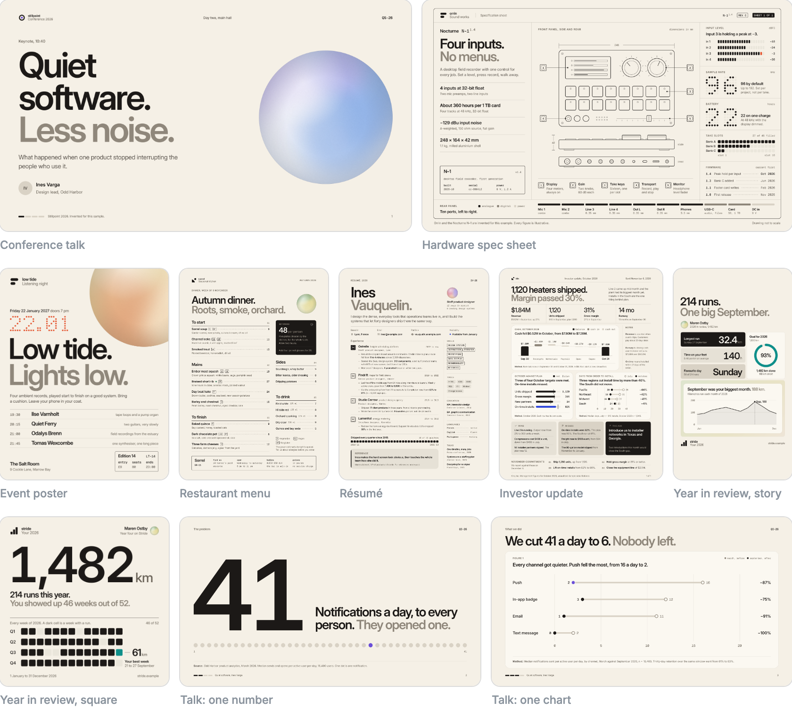
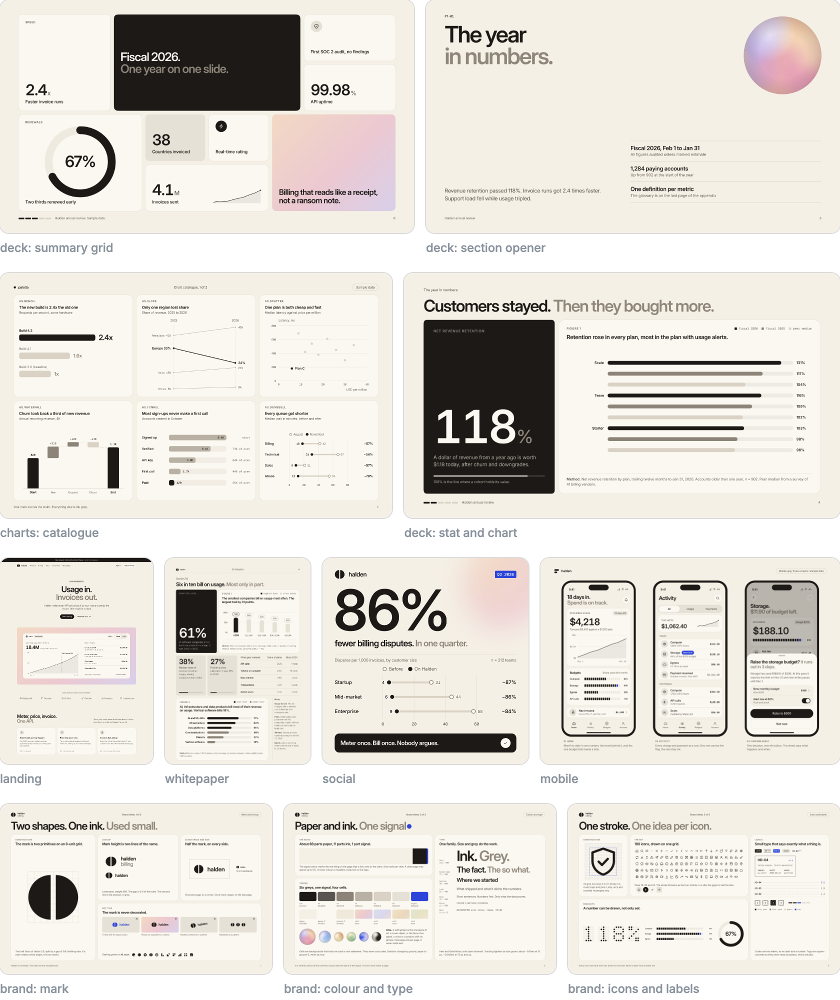
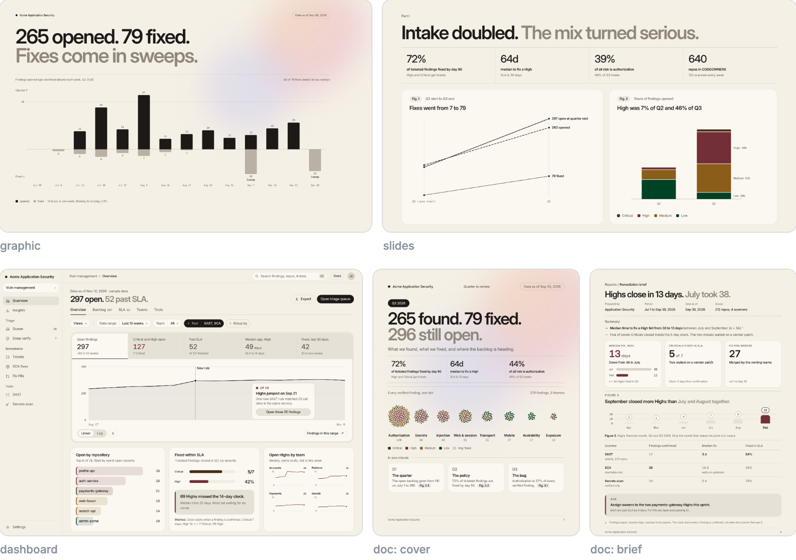

<p align="center">
  <picture>
    <source media="(prefers-color-scheme: dark)" srcset="docs/logo-dark.png">
    
  </picture>
</p>

<h3 align="center">A design skill for Claude Code</h3>

<p align="center">
Ask for a chart, a slide deck, a report, a dashboard, a landing page, app screens, a social image or a brand sheet.<br>
Get it in one editorial style, as PDF, PNG or live HTML.</p>

<p align="center">
  <a href="#install">Install</a> &nbsp;|&nbsp;
  <a href="#showcase">Showcase</a> &nbsp;|&nbsp;
  <a href="#templates">Templates</a> &nbsp;|&nbsp;
  <a href="#charts-and-icons">Charts and icons</a> &nbsp;|&nbsp;
  <a href="#the-rules-briefly">The rules</a>
</p>

<p align="center"></p>

## Install

```sh
git clone https://github.com/stilwellc/palette ~/.claude/skills/palette
```

Or as a plugin, from inside Claude Code (use one or the other, not both):

```
/plugin marketplace add stilwellc/palette
/plugin install palette@palette
```

Then ask Claude Code: *"make a five-slide board deck from this CSV"*, *"a one-page brief as a PDF"*,
*"an OG image for the launch post"*, *"chart last quarter's numbers"*.

palette is an [Agent Skill](https://docs.claude.com/en/docs/claude-code/skills): a folder of instructions,
templates and scripts that Claude reads when you ask for something visual. It picks the format, starts
from a template, renders, runs a layout check and looks at the result before handing you the files.

- **HTML in, PDF and PNG out.** Headless Chrome renders it. A layout check fails the build when
  content spills off a page, a chart hits its caption or colour goes over budget.
- **No npm, no build step, works offline.** 29 SVG chart helpers and 109 icons in two dependency-free
  scripts, fonts embedded.
- **PowerPoint and GIF too.** `scripts/pptx.py` writes a deck that opens in PowerPoint, Keynote and
  Google Slides (slides are pictures, with the text in the notes). `scripts/animate.sh` turns an
  animation page into a looping GIF; the one above is `templates/pitch.html`.
- **One style across every format.** Cream paper, big two-tone headlines, ink-grey charts, and one
  small signal colour per page.

<details>
<summary>Requirements</summary>

* Google Chrome, Chromium or Edge (headless, for HTML to PDF). Set `CHROME=/path/to/chrome` if it
  is somewhere unusual.
* PNG export: on macOS, Xcode command line tools (`xcode-select --install`), used once to build a
  small PDFKit rasteriser. On Linux, `pdftoppm` from poppler-utils.
* No npm, no build step. The charts are plain SVG from one dependency-free script.

</details>

## Showcase

Seven pieces made with the skill, each for a different invented brand with its own signal colour.

<p align="center"><a href="examples/"></a></p>

The sources are in [`examples/`](examples/). Every name and number in them is made up. Render one
yourself with `scripts/render.sh examples/poster.html out/`.

## Templates

Eleven starting points. The skill copies one, replaces the sample words and numbers, and renders.

<p align="center"><a href="templates/"></a></p>

| Format | Template | Canvas | For |
|---|---|---|---|
| graphic | [`graphic.html`](templates/graphic.html) | 1600×1000 (any size) | one chart, Slack image, social card |
| slides | [`slides.html`](templates/slides.html) | 1600×900 per slide | decks |
| doc | [`doc.html`](templates/doc.html) | US letter per page | reports, one-pagers, briefs |
| dash | [`dashboard.html`](templates/dashboard.html) | 1440 wide per screen | dashboards, console and UI mock-ups |
| deck | [`deck.html`](templates/deck.html) | 1600×900 per slide | board, pitch and product decks: 12 layouts |
| report | [`whitepaper.html`](templates/whitepaper.html) | A4 per page | white papers and industry reports |
| page | [`landing.html`](templates/landing.html) | 1440 wide | landing, product and pricing pages |
| mobile | [`mobile.html`](templates/mobile.html) | 390×844 screens | app screens in a phone frame |
| social | [`social.html`](templates/social.html) | 1200×630, 1080², 1080×1920, 1600×900 | link previews, square, story, announcement, all in one file |
| brand | [`brand.html`](templates/brand.html) | 1600×1000 per page | mark and lockup rules, colour, type, icons, labels |
| charts | [`charts.html`](templates/charts.html) | 1600×1000 | a catalogue with one working call per newer chart |

<details>
<summary>Severity mode: the original security-report style</summary>
<br>

Colour means Critical, High, Medium or Low and nothing else. The `graphic`, `slides`, `doc` and
`dashboard` templates use it. Opened in a browser, the dashboard is live: KPI tiles switch the main
chart and chart marks show tooltips.

<p align="center"></p>

</details>

## Charts and icons

`assets/charts.js` exposes `AS`. Every helper draws plain SVG into an element, with no dependencies.
[`templates/charts.html`](templates/charts.html) has a working call for each of the newer ones.

<details>
<summary>All 29 chart helpers</summary>
<br>

| Call | Draws |
|---|---|
| `AS.bars` | stacked or single vertical bars |
| `AS.diverging` | opened up, fixed down, per period |
| `AS.lines` | lines with end labels instead of a legend |
| `AS.hbars` | ranked horizontal bars |
| `AS.dots` | packed dot clusters, one dot per item |
| `AS.flow` | sankey |
| `AS.heat` | grey heat grid |
| `AS.strip` | dots on a linear or log axis |
| `AS.area` | dashboard time series, single or stacked by severity |
| `AS.compare` | comparison bars with one highlighted mark |
| `AS.track` | shares on a full-width track |
| `AS.multiples` | small multiples on a shared scale |
| `AS.mix` | thin severity-mix bar for a table cell |
| `AS.kpiSelect` | wires a KPI strip to swap the chart it controls |
| `AS.annotate` | curved leader and label for the one thing worth pointing at |
| `AS.bench` | benchmark bars with a big figure at the bar end |
| `AS.dumbbell` | before and after per row, with the change |
| `AS.slope` | one line per row between two moments |
| `AS.scatter` | scatter or bubble with one highlighted point |
| `AS.waterfall` | start, rises, falls, end |
| `AS.funnel` | steps with the share kept from the previous one |
| `AS.bullet` | value against a target tick |
| `AS.donut` | ring with the number inside |
| `AS.waffle` | unit grid you can count |
| `AS.meter` | segment level strip |
| `AS.stepgrid` | lanes of on, off and flagged cells |
| `AS.matrix` | dot-matrix readout for one number |
| `AS.spark` | sparkline for a cell or tile |
| `AS.gantt` | roadmap lanes with a today line |

</details>

`assets/icons.js` holds 109 line icons drawn for this skill on one 24-unit grid (one stroke, round
caps, one idea each), ten two-shape brand marks to start a logo from, and the painter for orbs:
soft gradient spheres in six palettes, the one piece of art the style allows.

```html
<i class="ic" data-i="shield-check"></i>
<i class="mk" data-m="dab"></i>
<i class="orbx dawn" style="--o:300px"></i>
```

## The rules, briefly

1. Almost no colour. About 88 parts paper, 11 parts ink, 1 part signal: one signal mark per page, on
   the thing that is live, new or the claim. In security work the four severity colours take its
   place and mean severity only. The two never share a page.
2. Headlines are two short clauses: the fact, then the consequence in grey.
   `248 found. 97 fixed. <em>290 still open.</em>`
3. A chart beats a table, and one strong chart beats two.
4. Bars start at zero. Outcomes come with a baseline and a window.
5. Every figure title is a sentence stating the finding, not a label.
6. Plain voice: short sentences, no filler, only claims the data proves.
7. Shapes nest and stay quiet: pills for controls, square tags, one ink block per page, no dark pages,
   shadows only on things that float.
8. The mark is two shapes in one ink, once per page. Other people's logos get one ink and one height.

The full guide is [`reference/style-guide.md`](reference/style-guide.md). Colour ratio, shape, marks,
icons and labels are in [`reference/brand.md`](reference/brand.md); deck, report, social, page and
mobile layouts in [`reference/layouts.md`](reference/layouts.md); UI rules in
[`reference/ui-patterns.md`](reference/ui-patterns.md). `SKILL.md` is what Claude reads.

## Run it without Claude

```sh
scripts/new.sh doc ~/work/Q4_Brief.html       # copy a template, asset paths made absolute
$EDITOR ~/work/Q4_Brief.html                  # replace the sample words and numbers
scripts/render.sh ~/work/Q4_Brief.html        # writes Q4_Brief.pdf and Q4_Brief-01.png ...
```

`render.sh` prints `check: data-check="OK"` when nothing spills off a page and no chart runs into
its note, and exits 2 when the layout check fails. It still writes the files so you can see why.

## Make it yours

The repo keeps a private layer out of git. Create `local/` (it is in `.gitignore`) and add:

* `local/NOTES.md`: your reference artefact, data sources and team rules. The skill reads it first.
* `local/templates/<kind>.html`: branded versions of any template. `scripts/new.sh` prefers them.

To rebrand, put one line at the top of a page's script. It derives every grey, card and ground from
three colours, and the charts follow:

```js
AS.theme({paper: '#eef1f4', ink: '#0e1c2f', signal: '#e4502a'})
```

To change the default for everything, edit the tokens at the top of `assets/style.css`. Nothing else
holds a colour: charts, icons and components all read those variables. Start a brand from
`templates/brand.html`: swap the mark, the name and the three colours.

<details>
<summary>What is in the repo</summary>

```
SKILL.md              instructions Claude follows
assets/style.css      tokens, components, the graphic / slides / doc formats
assets/ui.css         dashboard, product page, overlay and mobile layer
assets/charts.js      chart helpers (AS.*)
assets/icons.js       icons and brand marks
assets/check.js       layout check, result on <body data-check>
assets/fonts/         Inter and Geist Mono (OFL), embedded so renders work offline
templates/            eleven starting points, fictional data
examples/             seven finished pieces made with the skill (the showcase above)
reference/            style guide, brand layer, layouts, UI patterns
scripts/new.sh        start a piece from a template
scripts/render.sh     HTML to PDF to PNG, plus the layout check
scripts/pdf2png.swift macOS rasteriser, compiled on first run
docs/                 README screenshots
```

</details>

## Credits

Inter by Rasmus Andersson and Geist Mono by Vercel, both under the SIL Open Font License 1.1. The UI
layer borrows structure (hairline depth, pill controls, KPI strips that drive the chart) from a
study of well-made product sites. The brand layer borrows discipline from industrial product design
(nested radii, an accent budget, the summary grid) and from hardware instrument design (one signal
colour, label plates, segment and dot readouts). No logos, typefaces, colours, icons or images were
taken from any of them; every icon and mark in the repo was drawn for it.

## License

MIT for the code and templates. Fonts keep their own license; see `assets/fonts/`.
