# palette

A Claude Code skill that designs charts, slide decks, reports, dashboards, product pages, mobile
screens, social images and brand sheets in one consistent editorial style, and exports them as PDF
and PNG.

Cream paper, Inter, big two-tone headlines, charts in ink greys, and almost no colour: one small
signal mark per page, or the four severity colours when the work is about risk. It started as a
security team's report style and now covers general design work.

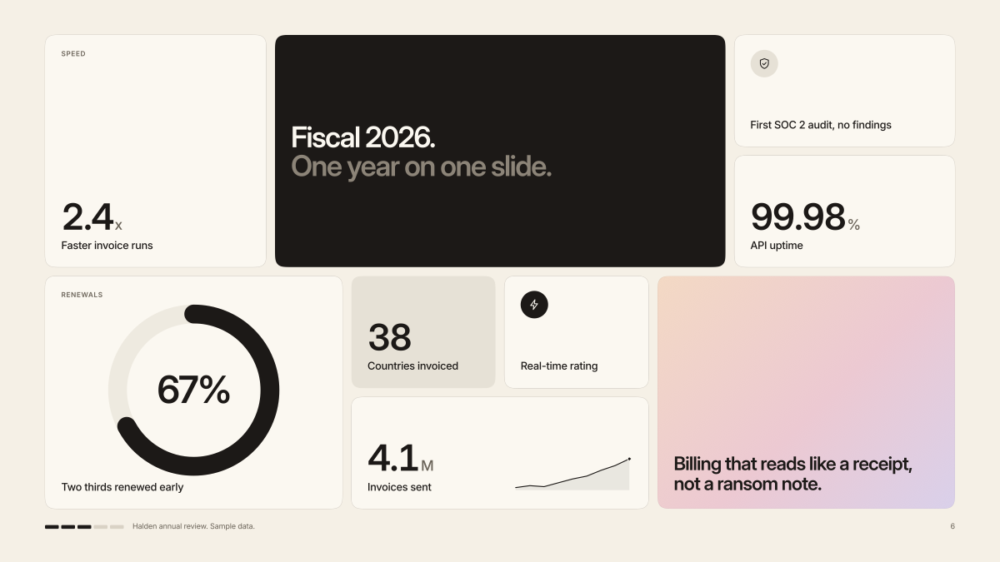

| Deck | Charts | Brand sheet |
|---|---|---|
| 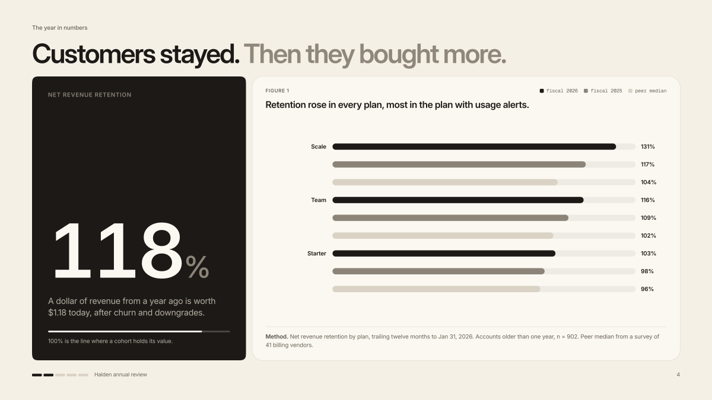 | 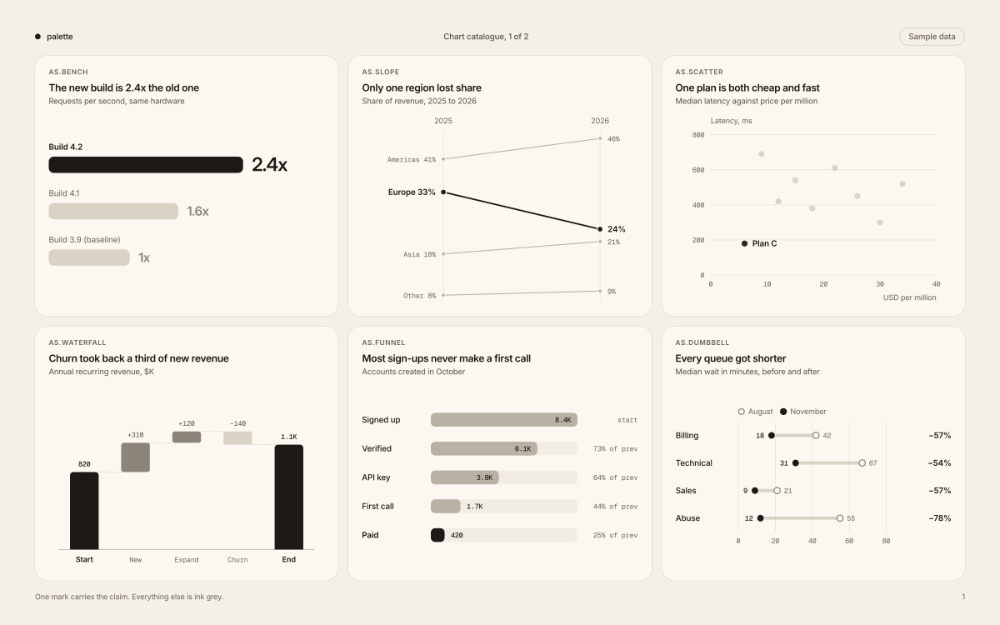 | 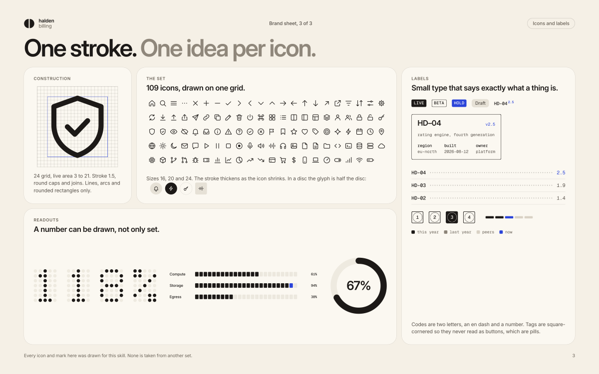 |

| Product page | Mobile | Report (A4) |
|---|---|---|
| 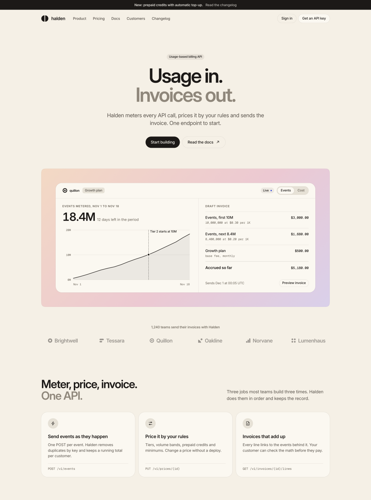 | 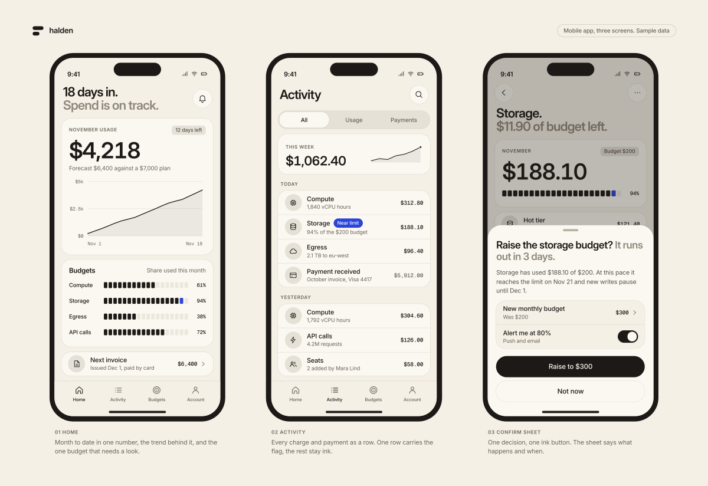 | 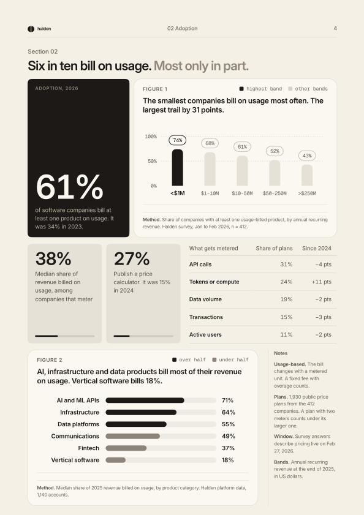 |

| Social image | Readouts | Mark and lockup |
|---|---|---|
| 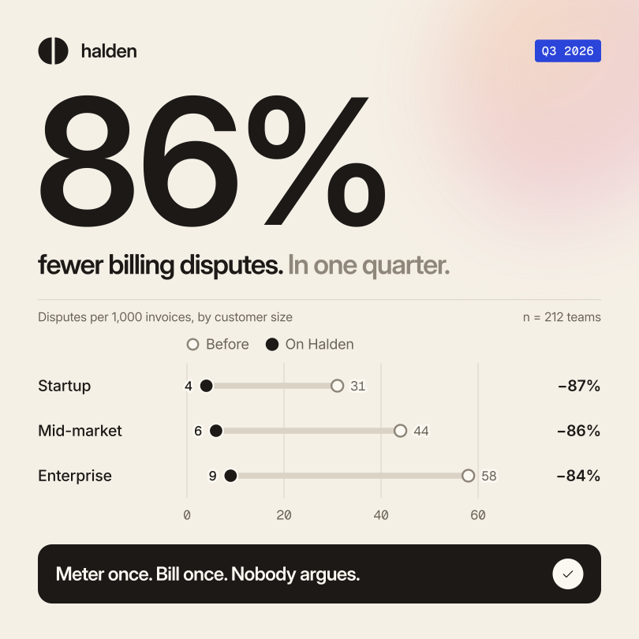 | 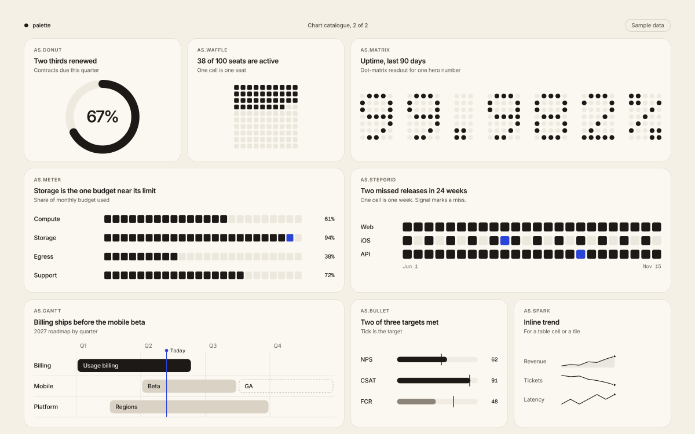 | 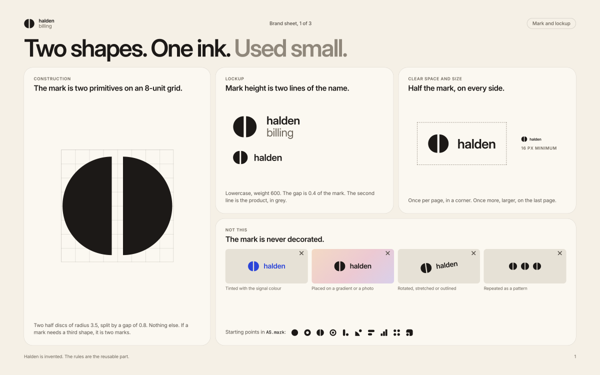 |

The original severity mode, where colour means Critical, High, Medium or Low and nothing else:

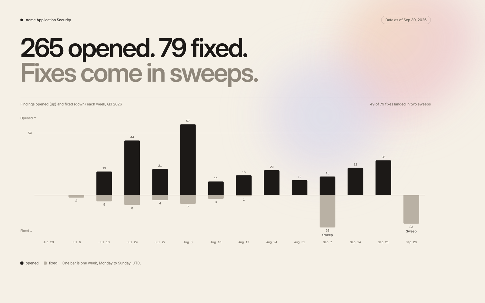

| Slides | Doc | Dashboard |
|---|---|---|
| 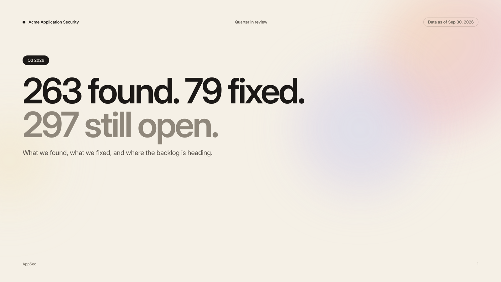 | 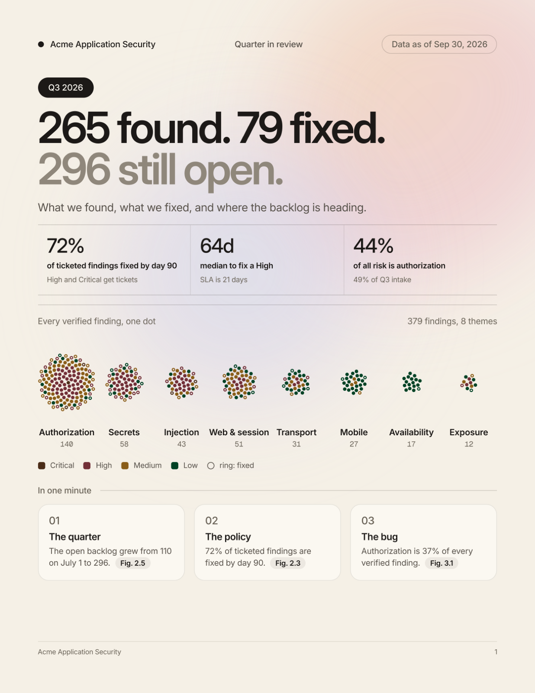 |  |

All data in the templates and screenshots is fictional.

## Install

```sh
git clone https://github.com/<you>/palette ~/.claude/skills/palette
```

Then ask Claude Code for a chart of last quarter's numbers, a one-page brief, a board deck, a
landing page, three mobile screens, a link-preview image or a brand sheet. The skill picks the format, starts from a template,
renders, runs a layout check and looks at the result before handing you the files.

### Requirements

* Google Chrome, Chromium or Edge (headless, for HTML to PDF). Set `CHROME=/path/to/chrome` if it
  is somewhere unusual.
* PNG export: on macOS, Xcode command line tools (`xcode-select --install`), used once to build a
  small PDFKit rasteriser. On Linux, `pdftoppm` from poppler-utils.
* No npm, no build step. The charts are plain SVG from one dependency-free script.

## Use it without Claude

```sh
scripts/new.sh doc ~/work/Q4_Brief.html       # copy a template, asset paths made absolute
$EDITOR ~/work/Q4_Brief.html                  # replace the sample words and numbers
scripts/render.sh ~/work/Q4_Brief.html        # writes Q4_Brief.pdf and Q4_Brief-01.png ...
```

`render.sh` prints `check: data-check="OK"` when nothing spills off a page and no chart runs into
its note, and exits 2 when the layout check fails. It still writes the files so you can see why.

## Formats

| Format | Template | Canvas | For |
|---|---|---|---|
| graphic | `templates/graphic.html` | 1600×1000 (any size) | one chart, Slack image, social card |
| slides | `templates/slides.html` | 1600×900 per slide | decks |
| doc | `templates/doc.html` | US letter per page | reports, one-pagers, briefs |
| dash | `templates/dashboard.html` | 1440 wide per screen | dashboards, console and UI mock-ups |
| deck | `templates/deck.html` | 1600×900 per slide | board, pitch and product decks: 12 layouts |
| report | `templates/whitepaper.html` | A4 per page | white papers and industry reports |
| page | `templates/landing.html` | 1440 wide | landing, product and pricing pages |
| mobile | `templates/mobile.html` | 390×844 screens | app screens in a phone frame |
| social | `templates/social.html` | 1200×630, 1080², 1080×1920, 1600×900 | link previews, square, story, announcement, all in one file |
| brand | `templates/brand.html` | 1600×1000 per page | mark and lockup rules, colour, type, icons, labels |
| charts | `templates/charts.html` | 1600×1000 | a catalogue with one working call per newer chart |

Opened in a browser, the dashboard is live: KPI tiles switch the main chart and chart marks show
tooltips. The PDF and PNG show its default state.

## Charts

`assets/charts.js` exposes `AS`. Every helper draws SVG into an element or selector.

| Call | Draws |
|---|---|
| `AS.bars` | stacked or single vertical bars |
| `AS.diverging` | opened up, fixed down, per period |
| `AS.lines` | lines with end labels instead of a legend |
| `AS.hbars` | ranked horizontal bars |
| `AS.dots` | packed dot clusters, one dot per item |
| `AS.flow` | sankey |
| `AS.heat` | grey heat grid |
| `AS.strip` | dots on a linear or log axis |
| `AS.area` | dashboard time series, single or stacked by severity |
| `AS.compare` | comparison bars with one highlighted mark |
| `AS.track` | shares on a full-width track |
| `AS.multiples` | small multiples on a shared scale |
| `AS.mix` | thin severity-mix bar for a table cell |
| `AS.kpiSelect` | wires a KPI strip to swap the chart it controls |
| `AS.annotate` | curved leader and label for the one thing worth pointing at |
| `AS.bench` | benchmark bars with a big figure at the bar end |
| `AS.dumbbell` | before and after per row, with the change |
| `AS.slope` | one line per row between two moments |
| `AS.scatter` | scatter or bubble with one highlighted point |
| `AS.waterfall` | start, rises, falls, end |
| `AS.funnel` | steps with the share kept from the previous one |
| `AS.bullet` | value against a target tick |
| `AS.donut` | ring with the number inside |
| `AS.waffle` | unit grid you can count |
| `AS.meter` | segment level strip |
| `AS.stepgrid` | lanes of on, off and flagged cells |
| `AS.matrix` | dot-matrix readout for one number |
| `AS.spark` | sparkline for a cell or tile |
| `AS.gantt` | roadmap lanes with a today line |

## Icons and marks

`assets/icons.js` holds 109 line icons drawn for this skill on one 24-unit grid (one stroke, round
caps, one idea each) and ten two-shape brand marks to start a logo from.

```html
<i class="ic" data-i="shield-check"></i>
<span class="lockup"><i class="mk" data-m="split"></i><span class="nm">halden<small>billing</small></span></span>
```

## The rules, briefly

1. Almost no colour. About 88 parts paper, 11 parts ink, 1 part signal: one signal mark per page, on
   the thing that is live, new or the claim. In security work the four severity colours take its
   place and mean severity only. The two never share a page.
2. Headlines are two short clauses: the fact, then the consequence in grey.
   `248 found. 97 fixed. <em>290 still open.</em>`
3. A chart beats a table, and one strong chart beats two.
4. Bars start at zero. Outcomes come with a baseline and a window.
5. Every figure title is a sentence stating the finding, not a label.
6. Plain voice: short sentences, no filler, only claims the data proves.
7. Shapes nest and stay quiet: pills for controls, square tags, one ink block per page, no dark pages,
   shadows only on things that float.
8. The mark is two shapes in one ink, once per page. Other people's logos get one ink and one height.

The full guide is [`reference/style-guide.md`](reference/style-guide.md). Colour ratio, shape, marks,
icons and labels are in [`reference/brand.md`](reference/brand.md); deck, report, social, page and
mobile layouts in [`reference/layouts.md`](reference/layouts.md); UI rules in
[`reference/ui-patterns.md`](reference/ui-patterns.md). `SKILL.md` is what Claude reads.

## Make it yours

The repo keeps a private layer out of git. Create `local/` (it is in `.gitignore`) and add:

* `local/NOTES.md`: your reference artefact, data sources and team rules. The skill reads it first.
* `local/templates/<kind>.html`: branded versions of any template. `scripts/new.sh` prefers them.

To change the look itself, edit the tokens at the top of `assets/style.css` (paper, ink, the four
severity colours) and the matching values in `assets/charts.js` (`SEV`, `N`). The signal colour is
one line: `AS.theme({signal: '#e4502a'})`, or `--signal` in the stylesheet. Start a brand from
`templates/brand.html`: swap the mark, the name and the signal.

## Layout

```
SKILL.md              instructions Claude follows
assets/style.css      tokens, components, the graphic / slides / doc formats
assets/ui.css         dashboard, product page, overlay and mobile layer
assets/charts.js      chart helpers (AS.*)
assets/icons.js       icons and brand marks
assets/check.js       layout check, result on <body data-check>
assets/fonts/         Inter and Geist Mono (OFL), embedded so renders work offline
templates/            eleven working examples, fictional data
reference/            style guide, brand layer, layouts, UI patterns
scripts/new.sh        start a piece from a template
scripts/render.sh     HTML to PDF to PNG, plus the layout check
scripts/pdf2png.swift macOS rasteriser, compiled on first run
docs/                 README screenshots
```

## Credits

Inter by Rasmus Andersson and Geist Mono by Vercel, both under the SIL Open Font License 1.1. The UI
layer borrows structure (hairline depth, pill controls, KPI strips that drive the chart) from a
study of well-made product sites. The brand layer borrows discipline from industrial product design
(nested radii, an accent budget, the summary grid) and from hardware instrument design (one signal
colour, label plates, segment and dot readouts). No logos, typefaces, colours, icons or images were
taken from any of them; every icon and mark in the repo was drawn for it.

## License

MIT for the code and templates. Fonts keep their own license; see `assets/fonts/`.
