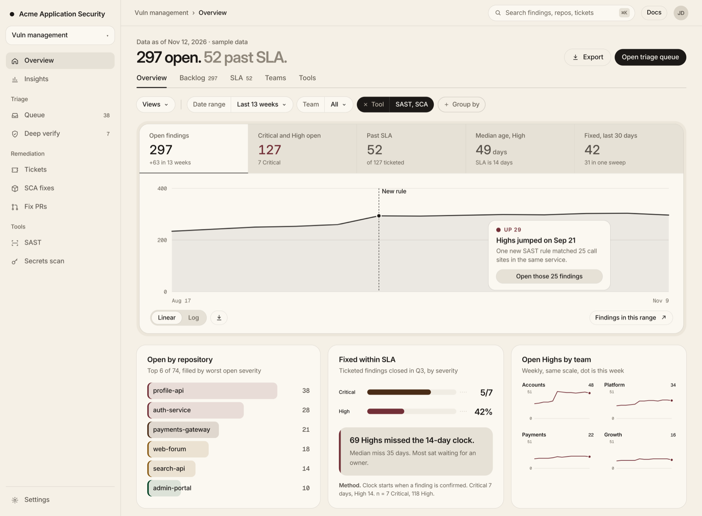

# palette

A Claude Code skill that turns numbers into charts, one-pagers, slide decks and dashboards in one
consistent editorial style, and exports them as PDF and PNG.

Cream paper, Inter, big two-tone headlines, ruled KPI strips, rounded figure cards, and charts in
ink greys where colour means one thing only: severity. It was built for an application security
team, so the defaults speak in findings, SLAs and fix rates, but nothing in it depends on that.


| Slides | Doc | Dashboard |
|---|---|---|
|  |  |  |

All data in the templates and screenshots is fictional.

## Install

```sh
git clone https://github.com/<you>/palette ~/.claude/skills/palette
```

Then ask Claude Code for something "in our style": a chart of last quarter's fixes, a one-page
brief, a five-slide deck, a dashboard mock-up. The skill picks the format, starts from a template,
renders, runs a layout check and looks at the result before handing you the files.

### Requirements

* Google Chrome, Chromium or Edge (headless, for HTML to PDF). Set `CHROME=/path/to/chrome` if it
  is somewhere unusual.
* PNG export: on macOS, Xcode command line tools (`xcode-select --install`), used once to build a
  small PDFKit rasteriser. On Linux, `pdftoppm` from poppler-utils.
* No npm, no build step. The charts are plain SVG from one dependency-free script.

## Use it without Claude

```sh
scripts/new.sh doc ~/work/Q4_Brief.html       # copy a template, asset paths made absolute
$EDITOR ~/work/Q4_Brief.html                  # replace the sample words and numbers
scripts/render.sh ~/work/Q4_Brief.html        # writes Q4_Brief.pdf and Q4_Brief-01.png ...
```

`render.sh` prints `check: data-check="OK"` when nothing spills off a page and no chart runs into
its note, and exits 2 when the layout check fails. It still writes the files so you can see why.

## Formats

| Format | Template | Canvas | For |
|---|---|---|---|
| graphic | `templates/graphic.html` | 1600×1000 (any size) | one chart, Slack image, social card |
| slides | `templates/slides.html` | 1600×900 per slide | decks |
| doc | `templates/doc.html` | US letter per page | reports, one-pagers, briefs |
| dash | `templates/dashboard.html` | 1440 wide per screen | dashboards, console and UI mock-ups |

Opened in a browser, the dashboard is live: KPI tiles switch the main chart and chart marks show
tooltips. The PDF and PNG show its default state.

## Charts

`assets/charts.js` exposes `AS`. Every helper draws SVG into an element or selector.

| Call | Draws |
|---|---|
| `AS.bars` | stacked or single vertical bars |
| `AS.diverging` | opened up, fixed down, per period |
| `AS.lines` | lines with end labels instead of a legend |
| `AS.hbars` | ranked horizontal bars |
| `AS.dots` | packed dot clusters, one dot per item |
| `AS.flow` | sankey |
| `AS.heat` | grey heat grid |
| `AS.strip` | dots on a linear or log axis |
| `AS.area` | dashboard time series, single or stacked by severity |
| `AS.compare` | comparison bars with one highlighted mark |
| `AS.track` | shares on a full-width track |
| `AS.multiples` | small multiples on a shared scale |
| `AS.mix` | thin severity-mix bar for a table cell |
| `AS.kpiSelect` | wires a KPI strip to swap the chart it controls |
| `AS.annotate` | curved leader and label for the one thing worth pointing at |

## The rules, briefly

1. Colour means severity (Critical, High, Medium, Low) and nothing else. Everything else is ink grey,
   darkest for what matters.
2. Headlines are two short clauses: the fact, then the consequence in grey.
   `248 found. 97 fixed. <em>290 still open.</em>`
3. A chart beats a table, and one strong chart beats two.
4. Bars start at zero. Outcomes come with a baseline and a window.
5. Every figure title is a sentence stating the finding, not a label.
6. Plain voice: short sentences, no filler, only claims the data proves.

The full guide is [`reference/style-guide.md`](reference/style-guide.md); dashboard rules are in
[`reference/ui-patterns.md`](reference/ui-patterns.md). `SKILL.md` is what Claude reads.

## Make it yours

The repo keeps a private layer out of git. Create `local/` (it is in `.gitignore`) and add:

* `local/NOTES.md`: your reference artefact, data sources and team rules. The skill reads it first.
* `local/templates/<kind>.html`: branded versions of any template. `scripts/new.sh` prefers them.

To change the look itself, edit the tokens at the top of `assets/style.css` (paper, ink, the four
severity colours) and the matching values in `assets/charts.js` (`SEV`, `N`).

## Layout

```
SKILL.md              instructions Claude follows
assets/style.css      tokens, components, the graphic / slides / doc formats
assets/ui.css         dashboard and app-UI layer
assets/charts.js      chart helpers (AS.*)
assets/check.js       layout check, result on <body data-check>
assets/fonts/         Inter and Geist Mono (OFL), embedded so renders work offline
templates/            one working example per format, fictional data
reference/            style guide and UI patterns
scripts/new.sh        start a piece from a template
scripts/render.sh     HTML to PDF to PNG, plus the layout check
scripts/pdf2png.swift macOS rasteriser, compiled on first run
docs/                 README screenshots
```

## Credits

Inter by Rasmus Andersson and Geist Mono by Vercel, both under the SIL Open Font License 1.1. The UI
layer borrows structure (hairline depth, pill controls, KPI strips that drive the chart) from a
study of well-made product sites. No logos, typefaces, colours or images were taken from them.

## License

MIT for the code and templates. Fonts keep their own license; see `assets/fonts/`.
